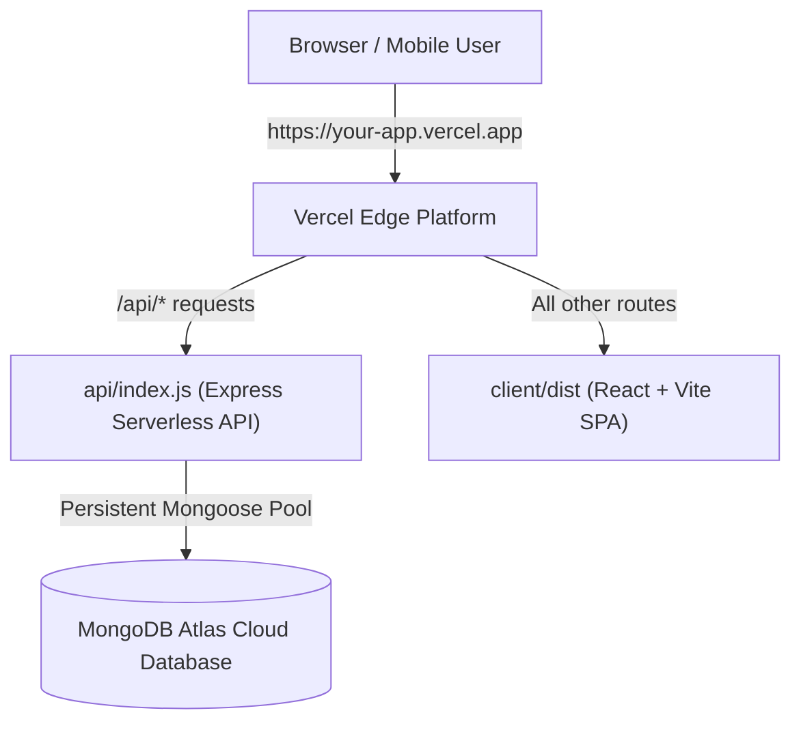

# DeepX Invoice System — DeepX Ai Solutions — Vercel Deployment Guide

Deploy the **entire application** (React Frontend + Express Backend API + Double-Entry Accounting) directly on **Vercel** as a single unified project on one domain, connected to a **MongoDB Atlas** cloud database.

---

## Architecture (Unified Vercel Deployment)



- **One Single Domain:** Both the UI and API run together on the same URL.
- **Zero CORS Issues:** API calls use `/api` without third-party cookie blocking.
- **Fast Global Delivery:** React SPA is delivered via Vercel's global CDN; API functions run on Vercel's serverless edge.

---

## Step 1: Create Free MongoDB Atlas Database (3 minutes)

1. Go to [https://www.mongodb.com/cloud/atlas/register](https://www.mongodb.com/cloud/atlas/register) and log in.
2. Click **Create** to create a new database.
3. Choose the **M0 Free** tier.
4. Select a region (e.g. `me-central-1` UAE or `eu-central-1` Frankfurt).
5. In the **Security Quickstart** step:
   - **Username:** `admin` (or your choice)
   - **Password:** Enter a strong password. Save this!
   - Click **Create Database User**.
6. Under **Where would you like to connect from?**:
   - Choose **Allow Access from Anywhere** (`0.0.0.0/0`).
   - Click **Add Entry**.
7. In Database Deployments, click **Connect** → **Drivers** (Node.js).
8. Copy your connection string:
   ```text
   mongodb+srv://admin:<password>@your-cluster.xxxx.mongodb.net/deepx_invoice_db?retryWrites=true&w=majority
   ```
   *(Ensure you replace `<password>` and append `/deepx_invoice_db` at the end).*

---

## Step 2: Deploy to Vercel (2 minutes)

1. Go to [https://vercel.com](https://vercel.com) and log in with your GitHub account.
2. Click **Add New...** → **Project**.
3. Import your repository:
   **`Irfan-CodeSynth/IMMIGRA-LINK-Business-Management-Invoicing-System`**
4. In the **Configure Project** screen:
   - **Framework Preset:** Select `Other` (or leave default — `vercel.json` automatically handles it).
   - **Root Directory:** Leave as `./` (the root of the project).
   - **Build Command:** Leave default (`npm run build`).
   - **Output Directory:** Leave default (`client/dist`).
5. Expand the **Environment Variables** section and add:

   | Name | Value |
   |---|---|
   | `MONGODB_URI` | `mongodb+srv://admin:<password>@your-cluster.xxxx.mongodb.net/deepx_invoice_db?retryWrites=true&w=majority` |
   | `JWT_SECRET` | `deepx_secure_secret_2026_ai_solutions` |
   | `NODE_ENV` | `production` |

6. Click **Deploy**.

---

## Step 3: That's It!

Vercel will build the frontend, package the serverless API, and assign you a live production URL.

### Super Admin Login Credentials
- **Email:** `info.deepxaisol@gmail.com`
- **Password:** `DeepX)88##`
- **Clean Database:** No demo invoices, quotations, customers, or services (ready for your real data)
- **Official UAE Chart of Accounts** (all balances ready at AED 0.00)
